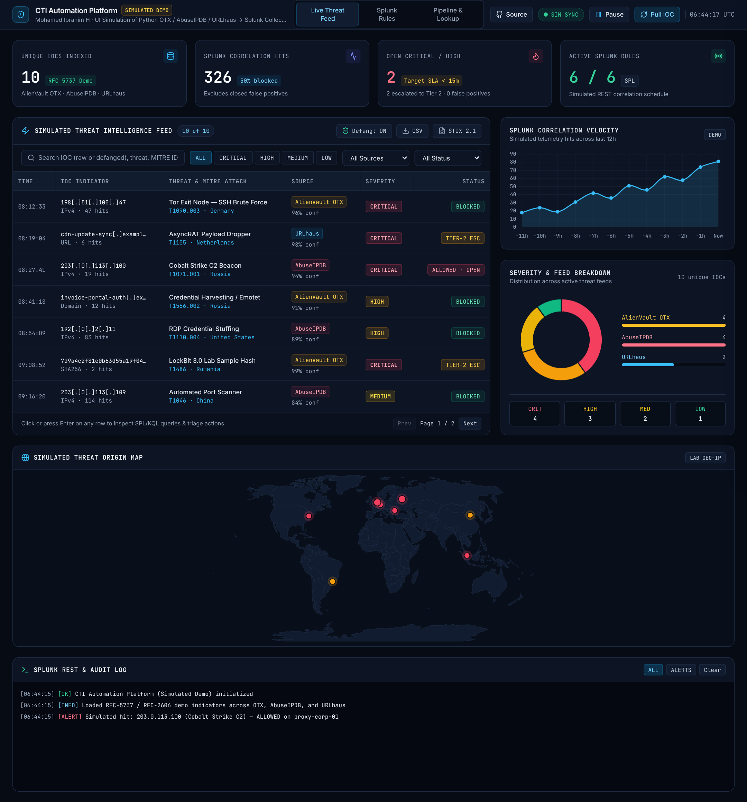
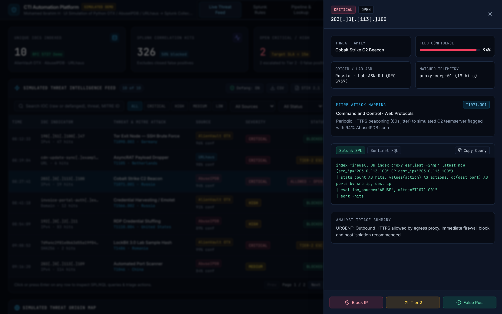
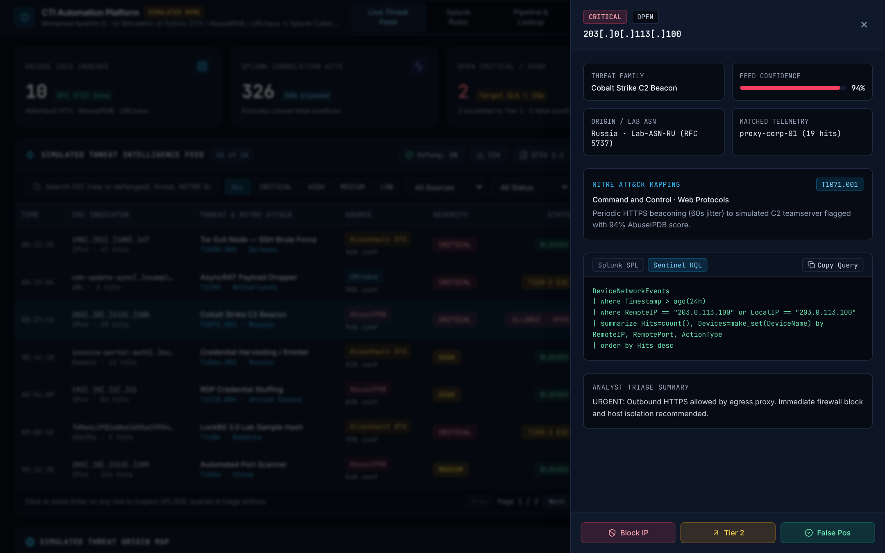
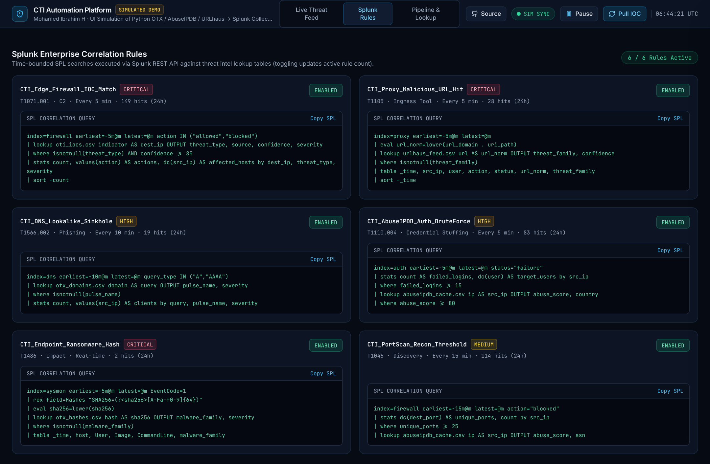
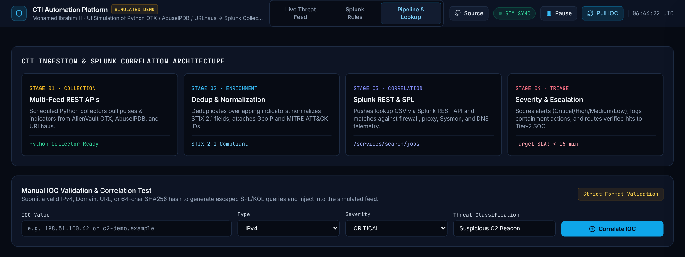

# 🛡️ CTI Automation Platform

> **Automated Cyber Threat Intelligence Pipeline with an Interactive SOC Dashboard**  
> *AlienVault OTX · AbuseIPDB · URLhaus · Splunk SPL · Microsoft Sentinel KQL*


<p align="center">
  
</p>

---

## 📌 Overview

A fully automated **Cyber Threat Intelligence (CTI) pipeline** that:

1. **Collects IOCs** (Indicators of Compromise) from 3 threat intelligence feeds
2. **Correlates** them against Splunk security logs to detect active threats
3. **Visualizes** everything in an interactive, dark-themed SOC dashboard with triage workflow

Built to demonstrate **SOC Tier 1/Tier 2** and **CTI Analyst** skills for enterprise blue team environments.

> ⚠️ **Demo data notice:** The dashboard ships with a **simulated dataset** (RFC 5737 IPs, RFC 2606 `.example` domains, lab hashes). It makes **no live API calls** and contains no real attacker infrastructure. The Python collector and correlator in this repo are the real pipeline; the dashboard is a UI simulation of their output.

---

## 🖼️ Dashboard Tour

### 1️⃣ Live Threat Feed
KPI strip, searchable/filterable IOC table, correlation velocity chart, severity and feed breakdown, threat origin map, and the Splunk REST audit log.


### 2️⃣ IOC Investigation Drawer: Splunk SPL
Click any row (or press Enter) to open enrichment, MITRE ATT&CK mapping, a ready-to-run **Splunk SPL** hunt query, analyst notes, and triage actions (Block / Tier 2 / False Positive).



### 3️⃣ IOC Investigation Drawer: Sentinel KQL
Same indicator, translated to **Microsoft Sentinel / Defender KQL** with one click.



### 4️⃣ Splunk Correlation Rules
Six time-bounded, MITRE-mapped correlation searches with schedule, 24h hit count, enable/disable toggle, and one-click **Copy SPL**.



### 5️⃣ Pipeline & Manual IOC Lookup
Four-stage ingestion architecture (Collection → Enrichment → Correlation → Triage) plus a strictly validated manual IOC form that generates escaped SPL/KQL and injects the indicator into the feed.



---

## 🎯 Features

| Feature | Description |
|---|---|
| 🔗 Multi-Feed Collection | Pulls IOCs from OTX, AbuseIPDB, URLhaus (Python collector) |
| 🧹 Dedup & Normalization | Merges overlapping indicators across feeds before correlation |
| 🔍 Splunk Correlation | Matches IOCs against Splunk log events via REST API (`/services/search/jobs`) |
| 🧭 MITRE ATT&CK Mapping | Every IOC carries a technique ID, tactic, and description |
| 📊 SOC Dashboard | KPIs, severity donut, feed breakdown, 12h correlation velocity chart |
| 🌐 Threat Origin Map | D3 + TopoJSON vector world map of attacker geography |
| 🔎 Search & Filters | Search raw **or defanged** values, threat names, MITRE IDs; filter by severity, source, status |
| 🛡️ Defang Toggle | Safe `[.]` / `hxxp` notation by default |
| 🧪 SPL + KQL Hunt Queries | Auto-generated, escaped queries per IOC for Splunk and Sentinel |
| 🧑‍💻 Triage Workflow | Block / Escalate to Tier 2 / False Positive, with status saved in the browser |
| 📤 Export | CSV (formula-injection safe) and **STIX 2.1** bundle (UUID IDs, correct SHA-256 patterns) |
| ✅ Input Validation | Strict IPv4 / Domain / URL / SHA256 checks on manual lookups |
| 🧾 Audit Log | Terminal-style Splunk REST and analyst action log with ALERT filter |
| ♿ Accessibility | Keyboard-navigable rows, `Esc` closes the drawer, ARIA roles, reduced-motion support |
| ⚡ Auto Severity | CRITICAL / HIGH / MEDIUM / LOW classification |
| 🔄 Demo Mode | Dashboard works fully offline, no API keys needed |

---

## 🏗️ Architecture

```
┌─────────────────────────────────────────────────────┐
│              CTI AUTOMATION PLATFORM                 │
├──────────────┬──────────────┬───────────────────────┤
│ AlienVault   │  AbuseIPDB   │       URLhaus          │
│    OTX       │  Blacklist   │   Malicious URLs       │
└──────┬───────┴──────┬───────┴──────────┬────────────┘
       │              │                  │
       └──────────────▼──────────────────┘
                 feeds/collector.py
                 (IOC Aggregator + Deduplication)
                        │
                        ▼
              data/iocs.json  ◄──── Stored IOCs
                        │
                        ▼
          correlator/splunk_correlator.py
          (Splunk REST API / Offline Correlation)
                        │
                        ▼
           data/correlation_hits.json
                        │
                        ▼
            dashboard/index.html
        (Interactive SOC Dashboard: SPL + KQL triage)
```

### Real pipeline vs. simulated dashboard

| Component | Status |
|---|---|
| `feeds/collector.py` | Real API collection (OTX, AbuseIPDB, URLhaus) |
| `correlator/splunk_correlator.py` | Real Splunk REST correlation, or offline mode on sample logs |
| `dashboard/index.html` | **Simulated** demo dataset (RFC 5737 / RFC 2606), no live calls |

---

## 📁 Project Structure

```
cti-platform/
├── feeds/
│   └── collector.py          # IOC collection from 3 threat feeds
├── correlator/
│   └── splunk_correlator.py  # Splunk REST API correlation engine
├── dashboard/
│   └── index.html            # Interactive SOC dashboard (single file)
├── docs/
│   └── screenshots/          # Dashboard tab screenshots used in this README
├── data/
│   ├── iocs.json             # Collected IOCs (auto-generated)
│   ├── correlation_hits.json # Alert matches (auto-generated)
│   └── sample/
│       └── sample_logs.json  # Sample log events for demo
├── main.py                   # Main orchestrator
├── requirements.txt          # Python dependencies
└── README.md
```

---

## ⚙️ Setup & Installation

### Prerequisites
- Python 3.10+
- Splunk Enterprise (optional; demo mode works without it)

### 1. Clone the repository
```bash
git clone https://github.com/ibu-cyx0/CTI-Automation-Platform
cd CTI-Automation-Platform
```

### 2. Install dependencies
```bash
pip install -r requirements.txt
```

### 3. Configure API keys (optional for live mode)
```bash
export OTX_API_KEY="your_otx_key_here"
export ABUSEIPDB_API_KEY="your_abuseipdb_key_here"
# URLhaus requires no API key
```

### 4. Run
```bash
# Demo mode (no API keys needed)
python main.py

# Live mode (with API keys + Splunk)
export SPLUNK_HOST="localhost"
export SPLUNK_USER="admin"
export SPLUNK_PASS="yourpassword"
python main.py
```

### 5. Open the Dashboard
```
Open dashboard/index.html in your browser
```
The dashboard loads its charting and map libraries from public CDNs, so keep an internet connection on for the first load.

---

## 🔐 Threat Feeds Used

| Feed | Type | Data | API Required |
|---|---|---|---|
| [AlienVault OTX](https://otx.alienvault.com) | Community | IPs, Domains, Hashes, URLs | ✅ Free |
| [AbuseIPDB](https://www.abuseipdb.com) | Crowd-sourced | Malicious IPs with confidence score | ✅ Free |
| [URLhaus](https://urlhaus.abuse.ch) | Malware | Active malware delivery URLs | ❌ No key |

---

## 🧩 Splunk Correlation Rules

| Rule | MITRE | Severity | Schedule |
|---|---|---|---|
| `CTI_Edge_Firewall_IOC_Match` | T1071.001 · C2 | CRITICAL | Every 5 min |
| `CTI_Proxy_Malicious_URL_Hit` | T1105 · Ingress Tool Transfer | CRITICAL | Every 5 min |
| `CTI_DNS_Lookalike_Sinkhole` | T1566.002 · Phishing | HIGH | Every 10 min |
| `CTI_AbuseIPDB_Auth_BruteForce` | T1110.004 · Credential Stuffing | HIGH | Every 5 min |
| `CTI_Endpoint_Ransomware_Hash` | T1486 · Impact | CRITICAL | Real-time |
| `CTI_PortScan_Recon_Threshold` | T1046 · Discovery | MEDIUM | Every 15 min |

---

## 🔍 Sample Queries

**Splunk SPL: edge firewall IOC match**
```spl
index=firewall earliest=-5m@m latest=@m action IN ("allowed","blocked")
| lookup cti_iocs.csv indicator AS dest_ip OUTPUT threat_type, source, confidence, severity
| where isnotnull(threat_type) AND confidence >= 85
| stats count, values(action) AS actions, dc(src_ip) AS affected_hosts by dest_ip, threat_type, severity
| sort -count
```

**Splunk SPL: ransomware hash on endpoints (Sysmon)**
```spl
index=sysmon earliest=-5m@m latest=@m EventCode=1
| rex field=Hashes "SHA256=(?<sha256>[A-Fa-f0-9]{64})"
| eval sha256=lower(sha256)
| lookup otx_hashes.csv hash AS sha256 OUTPUT malware_family, severity
| where isnotnull(malware_family)
| table _time, host, User, Image, CommandLine, malware_family
```

**Microsoft Sentinel / Defender KQL: network hunt for an IOC**
```kql
DeviceNetworkEvents
| where Timestamp > ago(24h)
| where RemoteIP == "203.0.113.100" or LocalIP == "203.0.113.100"
| summarize Hits=count(), Devices=make_set(DeviceName) by RemoteIP, RemotePort, ActionType
| order by Hits desc
```

---

## 🛠️ Tech Stack

- **Python**: feed collection, correlation logic
- **Splunk REST API**: log correlation (`/services/search/jobs/export`)
- **AlienVault OTX / AbuseIPDB / URLhaus APIs**: threat feeds
- **Splunk SPL + Microsoft Sentinel KQL**: detection and hunting queries
- **MITRE ATT&CK + STIX 2.1**: technique mapping and indicator export
- **HTML / Tailwind CSS / JavaScript**: dashboard UI
- **Chart.js**: severity and velocity charts
- **D3.js + TopoJSON**: vector threat origin map
- **Docker** (optional): containerized deployment

---

## 🗺️ Roadmap

- [ ] Feed `data/iocs.json` and `data/correlation_hits.json` into the dashboard (live mode)
- [ ] MISP integration for threat sharing
- [ ] Automated email alerting (SMTP)
- [ ] Elasticsearch support
- [ ] TAXII server/client support (STIX 2.1 export already available)
- [ ] ML-based IOC prioritization

---

## 👤 Author

**Mohamed Ibrahim H**  
EC-Council Certified SOC Analyst (CSA) | Splunk Core Certified User | Cisco Cyber Ops Associate

- GitHub: [@ibu-cyx0](https://github.com/ibu-cyx0)
- TryHackMe: [@IbrahimCyb3r4](https://tryhackme.com/p/IbrahimCyb3r4)
- Portfolio: [ibrahim-cybrx.is-a.dev](https://ibrahim-cybrx.is-a.dev/)
- Email: ibrahim.cybrx@gmail.com

---

## 📄 License

MIT License. Free to use, modify, and distribute.
